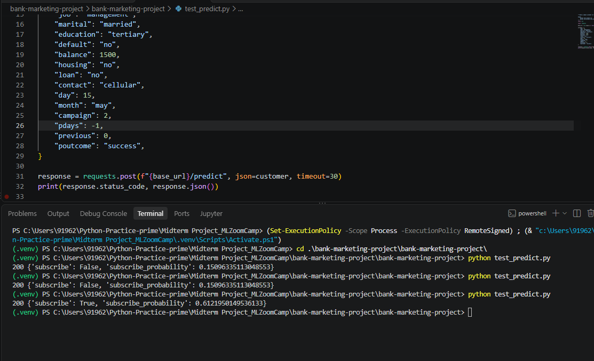

# Data

Dataset: **Bank Marketing** (UCI Machine Learning Repository, id 222), file `bank-full.csv`
(45,211 rows, 16 input columns + target `y`, separator `;`).

## Download

From the project root:

```bash
mkdir -p data && cd data
curl -L -o bank-marketing.zip "https://archive.ics.uci.edu/static/public/222/bank+marketing.zip"
unzip -o bank-marketing.zip      # gives bank.zip and bank-additional.zip
unzip -o bank.zip                # gives bank-full.csv, bank.csv, bank-names.txt
cd ..
```

`data/bank-full.csv` must exist before you run the notebook or `train.py`.

If `curl` is not available, open https://archive.ics.uci.edu/dataset/222/bank+marketing,
click "Download", and extract `bank-full.csv` into the `data/` folder.

Source paper: S. Moro, P. Cortez and P. Rita, "A Data-Driven Approach to Predict the Success
of Bank Telemarketing", Decision Support Systems, 2014.


